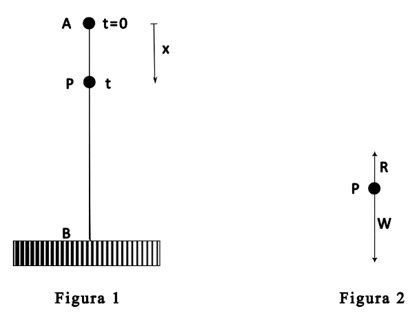

# Proyecto programado 1 — Paradigma imperativo/procedimental

**Curso:** IC4700 Lenguajes de Programación  
**Periodo:** Segundo semestre de 2026  
**Grupo:** 2  

Documento original: [`original/Proyecto_2026-2-1.docx`](original/Proyecto_2026-2-1.docx)

---

## Descripción general

Diseñar un algoritmo para resolver numéricamente una ecuación diferencial ordinaria, y escribir versiones de este en tres lenguajes de programación imperativos/procedimentales distintos, en la modalidad de **programación estructurada**.

## Objetivos didácticos

- Consolidar la comprensión del paradigma imperativo/procedimental.
- Preparar en las ideas de la programación estructurada (por su influencia en otros paradigmas).
- Entrenar en programación científica y modelación matemática con computadora.
- Entrenar en técnicas de programación automática con IA generativa, bajo restricciones de mantenibilidad.
- Hacer conscientes de la necesidad de conocer los lenguajes para someter a prueba los resultados generados por IA.

## Descripción detallada

El problema consiste en diseñar un algoritmo con programación estructurada para una situación del mundo real modelada con ecuaciones diferenciales. Una vez diseñado, se expresa el mismo algoritmo en tres lenguajes: **Pascal**, **C** y **Fortran**.

---

## El problema de la caída amortiguada

Supongamos que un paracaidista (con su paracaídas) cae desde el reposo. El peso combinado del paracaidista y su paracaídas es \(W\). El paracaídas tiene una fuerza de resistencia del aire proporcional a la velocidad en cualquier instante.

Asumiendo caída vertical y paracaídas ya abierto al iniciar el salto, se requiere resolver:

1. La función que describe la **velocidad** del paracaidista.
2. La **distancia** recorrida respecto al tiempo.
3. El valor de una **constante** esencial para el diseño del paracaídas, de modo que el aterrizaje sea sin incidentes.

---

## Modelación matemática

### Segunda Ley de Newton

De forma simple:

\[
F = ma
\]

Usando el peso \(W\) en lugar de la masa (\(W = mg\)):

\[
W = mg \quad\Rightarrow\quad m = \frac{W}{g}
\]

### Diagramas

La figura 1 muestra la situación física y la figura 2 el diagrama de fuerzas:

- \(A\): inicio del salto (\(t = 0\))
- \(P\): punto cualquiera de la trayectoria en el instante \(t\)
- \(B\): suelo
- \(x\): distancia recorrida en el tiempo \(t\) (positiva hacia abajo)
- \(W\): peso (hacia abajo)
- \(R\): resistencia del aire (hacia arriba)

### Modelación precisa

Tomando \(A\) como origen y el segmento \(AB\) en la dirección del eje \(y\) positivo (hacia abajo):

- Peso combinado \(W\) hacia abajo.
- Resistencia \(R\) hacia arriba, proporcional a la velocidad \(v\):

\[
R = \beta v
\]

donde \(\beta\) es la constante de proporcionalidad.

Fuerza neta hacia abajo: \(W - R = W - \beta v\).

Por Newton:

\[
W - \beta v = \frac{W}{g}\cdot\frac{dv}{dt}
\]

Condición inicial: \(v = 0\) cuando \(t = 0\).

Problema de valor inicial completo:

\[
\frac{W}{g}\cdot\frac{dv}{dt} = W - \beta v, \quad\text{con } v=0 \text{ cuando } t=0
\]

---

## Solución analítica

La EDO es de variables separables:

\[
\frac{W\,dv}{W - \beta v} = g\,dt
\quad\Rightarrow\quad
-\frac{W}{\beta}\ln(W - \beta v) = gt + C
\]

Con \(v=0\) en \(t=0\):

\[
C = -\frac{W}{\beta}\ln W
\]

Luego:

\[
v(t) = \frac{W}{\beta}\left(1 - e^{-\beta g t / W}\right)
\]

Cuando \(t\) crece, \(v\) tiende a la velocidad límite \(W/\beta\).

Para la distancia, partiendo de \(dx/dt = v(t)\) con \(x=0\) en \(t=0\):

\[
x(t) = \frac{W}{\beta}\,t + \frac{W}{\beta g}\,e^{-\beta g t / W} - \frac{W}{\beta g}
\]

---

## Solución numérica — Runge-Kutta de cuarto orden

En la práctica no siempre existe forma cerrada. Se pide implementar el método de **Runge-Kutta de cuarto orden**.

Se ajusta la ecuación a la forma:

\[
y' = f(t, y),\quad a \le t \le b,\quad y(a)=\alpha
\]

Se calculan \(N+1\) puntos igualmente espaciados en \([a,b]\) con paso:

\[
h = \frac{b-a}{N}
\]

El método produce pares \((t_i, w_i)\) con \(y(t_i) \approx w_i\):

\[
\begin{aligned}
w_0 &= \alpha,\\
k_1 &= h\,f(t_i, w_i),\\
k_2 &= h\,f\!\left(t_i+\frac{h}{2},\, w_i+\frac{1}{2}k_1\right),\\
k_3 &= h\,f\!\left(t_i+\frac{h}{2},\, w_i+\frac{1}{2}k_2\right),\\
k_4 &= h\,f(t_{i+1},\, w_i+k_3),\\
w_{i+1} &= w_i + \frac{1}{6}(k_1 + 2k_2 + 2k_3 + k_4).
\end{aligned}
\]

para \(i = 0, 1, \ldots, N-1\) (con \(t_{i+1} = t_i + h\)).

---

## Pregunta de investigación

Mediante los programas, de forma experimental, encontrar el valor de \(\beta\) (proporción de resistencia del paracaídas) tal que, desde una altura de **1500 m**, una persona de **80 kg** con equipamiento de **50 kg**, llegue al suelo a una velocidad de aproximadamente **8 km/h**. El valor debe hallarlo el algoritmo.

---

## Condiciones de elaboración y entrega

1. Elaborar diagramas de **Nassi-Shneiderman** con el diseño del algoritmo, **sin especificar lenguaje**. El diagrama es la plantilla para todos los programas.
2. El algoritmo debe estar **bien estructurado**, con especial énfasis en **coupling** y **binding** (cohesión).
3. Presentar el algoritmo en tres versiones: **C**, **Pascal** y **FORTRAN**. Se pueden usar herramientas de IA para automatizar el diseño, en todo o en parte.
4. El algoritmo debe aceptar tres parámetros del usuario:
   - peso del paracaidista
   - peso de la impedimenta
   - altura de salto

## Referencias / Bibliografía

- [Spiegel83] Spiegel, Murray. *Ecuaciones Diferenciales Aplicadas*. México DF: Prentice-Hall, 1983. (pp. 76–78)
- [Burden85] Burden, Richard L.; J. Douglas Faires. *Análisis Numérico*. México DF: Grupo Editorial Iberoamérica, 1985. (p. 248)
